<div align="center">

# ErgoDox EZ · CNC Aluminium Case

**A parametric two-piece aluminium case for the ErgoDox EZ, designed for CNC milling and written as one Python script.**

[](https://github.com/w0rxbend/ergodox/actions/workflows/build.yml)
[](https://github.com/w0rxbend/ergodox/releases/latest)
[](https://w0rxbend.github.io/ergodox/)
[](https://github.com/gumyr/build123d)
[](LICENSE)

[**Live 3D viewer**](https://w0rxbend.github.io/ergodox/) ·
[Download](https://github.com/w0rxbend/ergodox/releases/latest) ·
[Order guide](docs/jlccnc-order.md) ·
[Fit check](docs/fit-check.md) ·
[Design notes](docs/design.md)

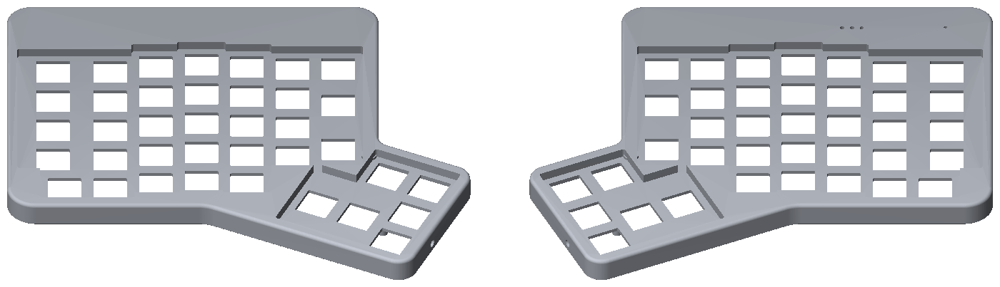

</div>

The case takes the stock EZ PCB, switches and keycaps. One
[build123d](https://github.com/gumyr/build123d) script ([`cad/ergodox_case.py`](cad/ergodox_case.py))
produces STEP files for the machine shop, STL files for a 3D-printed test fit, a 1:1 DXF for checking your
PCB, and PDF manufacturing drawings with thread tables. CI rebuilds everything on every push.

## Spin it in your browser

[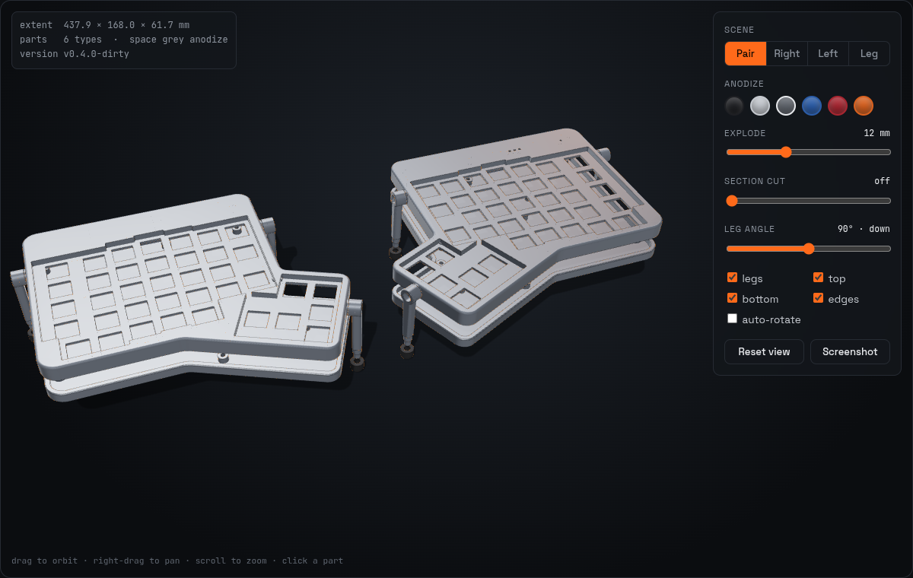](https://w0rxbend.github.io/ergodox/)

**[w0rxbend.github.io/ergodox](https://w0rxbend.github.io/ergodox/)** has a three.js viewer that loads the
STL files from the latest `main` build. You can:

- switch between the pair, either half, or a single leg;
- try anodize colours;
- explode the top shell off the tray;
- sweep a section plane through the parts;
- click the legs through their 10° detent steps;
- hover a part to see its size and mass;
- download any part as STL.

## Features

- **Exact key layout.** The 38 switch positions per half, the column stagger and the 25° thumb cluster
  come from the original ErgoDox KiCad PCB. The EZ uses the same key matrix.
- **Integrated top-mount plate.** The 1.5 mm switch plate is milled into the top shell and sits in
  a 4 mm key well, so the case has no separate plate. A separate 3 mm **plate spacer** fills the gap
  between the plate and the PCB, with an opening around every switch.
- **PCB clamped between top and bottom.** The PCB sits between bosses in the top shell and posts in the
  bottom tray, held by 8 × M2.5 countersunk screws on the original ErgoDox hole pattern.
- **Matches the EZ:**
  - TRRS openings on both halves.
  - USB, 3 LED windows and the reset hole on the right half only.
  - **Tent/tilt legs** with click stops: a tapped M3 hole with a toothed Ø10 detent boss in the case,
    and a **custom CNC leg** whose hub teeth are the exact negative of the boss. It uses the stock EZ
    M3 spring thumbscrew. See [docs/legs.md](docs/legs.md).
- **Designed for milling.** Internal corners are R ≥ 1 mm, and the jack notches open towards the
  parting plane. The top takes 2 setups plus a side setup for the leg bosses; the bottom takes 2 setups.
- **Fully parametric.** Every dimension is a named constant at the top of
  [`cad/ergodox_case.py`](cad/ergodox_case.py).

| | |
|---|---|
| Size per half | 194.4 × 168.0 × 17.6 mm (including the leg bosses) |
| Mass per half (6061-T6) | ≈ 357 g (top 144 g + bottom 213 g), plus the plate spacer |
| Fasteners per half | 6 × M2.5×14 + 2 × M2.5×12 countersunk (ISO 10642) |
| Feet | 4 × Ø10 mm rubber bumpers in 0.6 mm recesses |
| Tent/tilt legs | 3 custom legs (5 g, 6061) + TPU foot caps + stock M3 thumbscrews per half |

## How it fits together

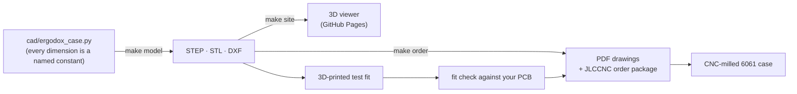

The stack from the bottom up: the **bottom tray** (Z 0–7), the **PCB**, clamped between posts in the
tray and bosses in the top, and the **top shell** (Z 7–17.6), with the 1.5 mm plate milled into its
key well. The **legs** screw into toothed bosses on the outer walls of the top shell.

## Download

Ready-made files are attached to every [GitHub release](../../releases):

- `ergodox-cnc-case-<version>-stl.zip` contains the STL files (4 case parts, 2 plate spacers, the leg and its foot cap), for a 3D-printed test fit.
- `ergodox-cnc-case-<version>-step.zip` contains the STEP files (case parts and leg) and `ergodox_right_fitcheck.dxf`, for CAM or a CNC shop.
- `ergodox-cnc-case-<version>-jlccnc-order.zip` is a ready-to-upload order package: each STEP plus a PDF
  manufacturing drawing (threads, detent teeth, tolerances, finish) and a hole table. See
  [docs/jlccnc-order.md](docs/jlccnc-order.md).

> [!WARNING]
> The case outline was measured from photos (±1–2 mm). Work through
> [docs/fit-check.md](docs/fit-check.md) and **3D-print a test fit before machining aluminium**.

## Build from source

You need Python **3.10–3.13**. build123d/OCP has no wheels for 3.14 yet.

```sh
make setup      # creates .venv and installs requirements.txt
make model      # writes exports/*.step, *.stl and the fit-check DXF
make renders    # refreshes renders/*.png from the exports
make order      # PDF drawings + order package in exports/order (needs model)
make serve      # builds the microsite into _site/ and serves it on localhost:8000
make help       # lists all targets
```

`make model` prints a build report: screw-to-switch clearances, tent-leg wall checks, and each part's
mass, size and geometry validity. It exits non-zero if any part is not a single valid solid.

To use another interpreter, run `make PYTHON=/path/to/python model`.

## Repository layout

```
cad/ergodox_case.py      parametric model: all dimensions, geometry and export
cad/drawings.py          PDF manufacturing drawings + CNC order package
tools/                   preview helpers: z-buffer renderer, cross-section, photo overlay; site builder
site/                    GitHub Pages microsite: three.js viewer (models are added at build time)
renders/                 preview images used in the docs
docs/                    design notes, fit check, machining guide, sources
docs/photos/             reference photos of a stock ErgoDox EZ
.github/workflows/       CI: build on every push, deploy the site from main, publish a release on v* tags
exports/                 (git-ignored) generated STEP/STL/DXF
```

## Documentation

| Document | Contents |
|---|---|
| [docs/design.md](docs/design.md) | Where each dimension comes from, the coordinate frame, the Z stack, part breakdown |
| [docs/legs.md](docs/legs.md) | Tent/tilt legs: the M3 detent boss, the custom leg, measurements, what to check |
| [docs/fit-check.md](docs/fit-check.md) | What to measure on your keyboard before machining |
| [docs/machining.md](docs/machining.md) | Bill of materials, setups, tooling, finishing |
| [docs/jlccnc-order.md](docs/jlccnc-order.md) | Ordering from JLCCNC: form settings, remarks to paste (EN/中文), answers to engineering questions |
| [docs/sources.md](docs/sources.md) | References and prior art |

## Previews

| Top shell, underside | Bottom tray |
|---|---|
| 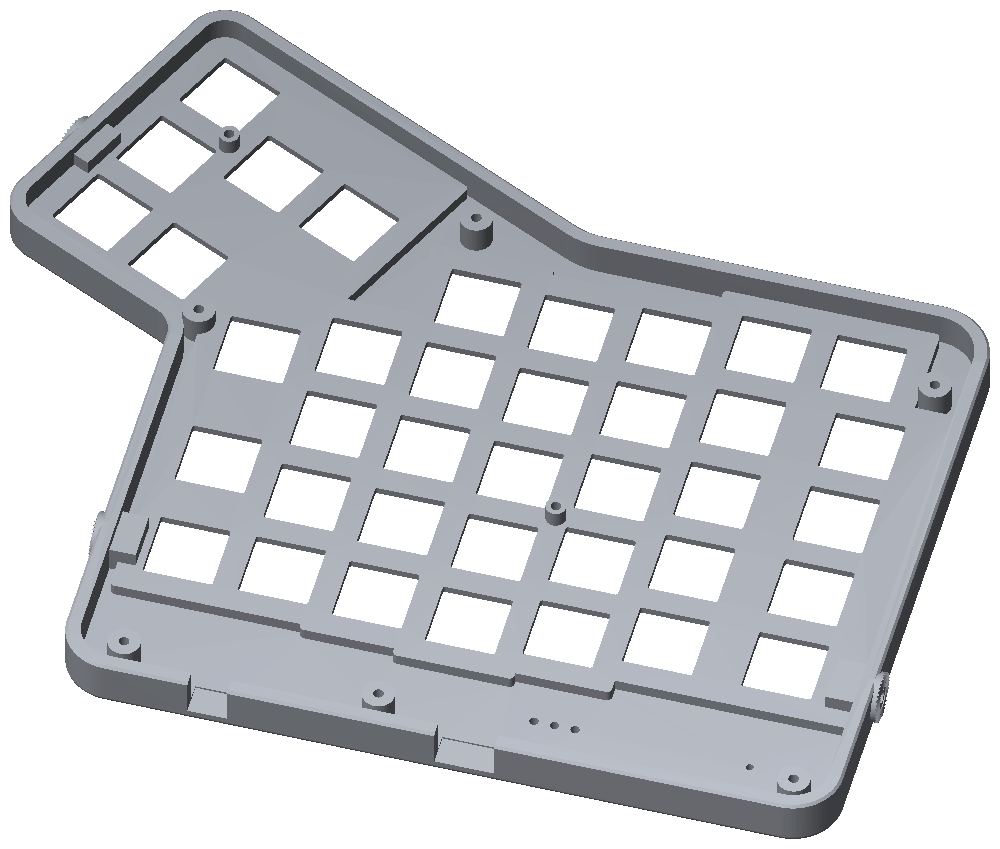 | 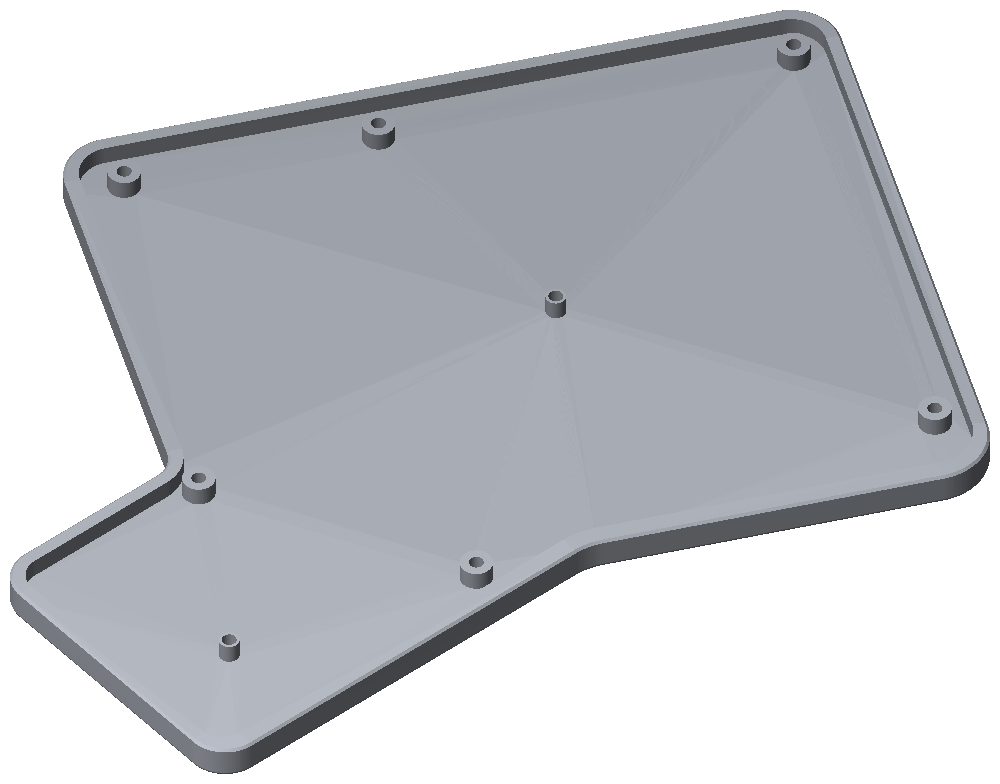 |

The plate spacer, a separate 3 mm part between the plate and the PCB:

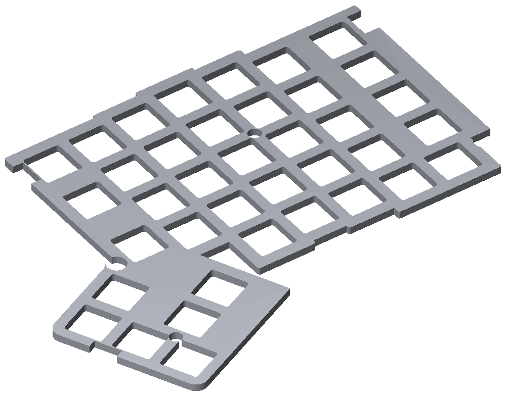

The model overlaid on a photo of a real EZ. Red is the outline, blue the key well, green the switch
cutouts and magenta the holes:

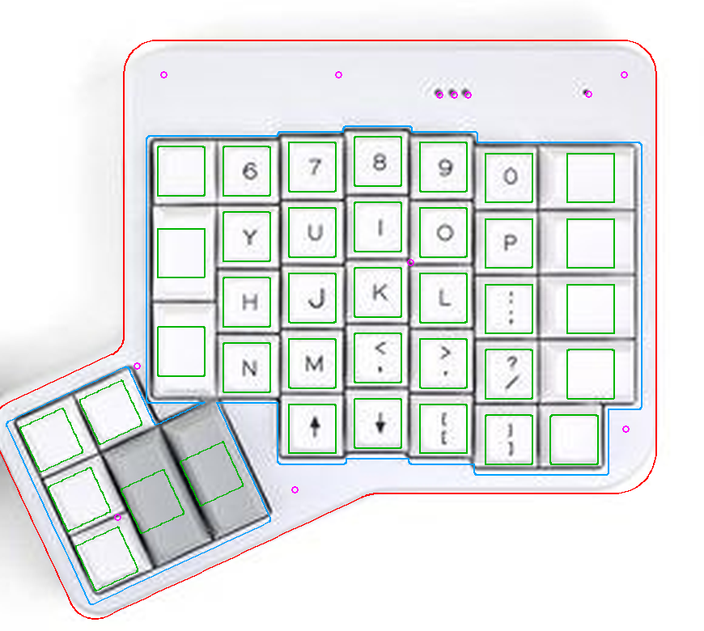

The custom tent legs, deployed, with a section through the outer leg mount:

| Assembly preview | Leg mount section |
|---|---|
| 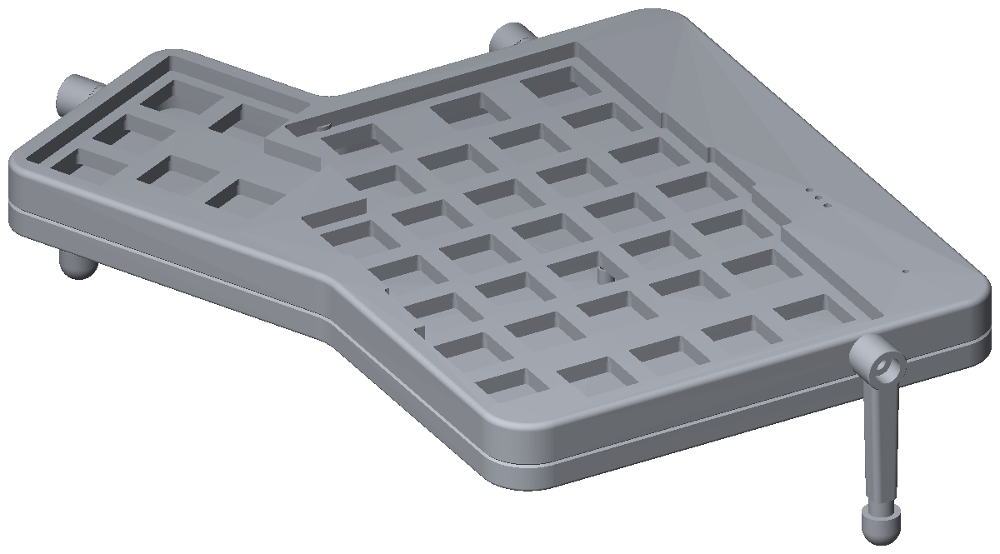 | 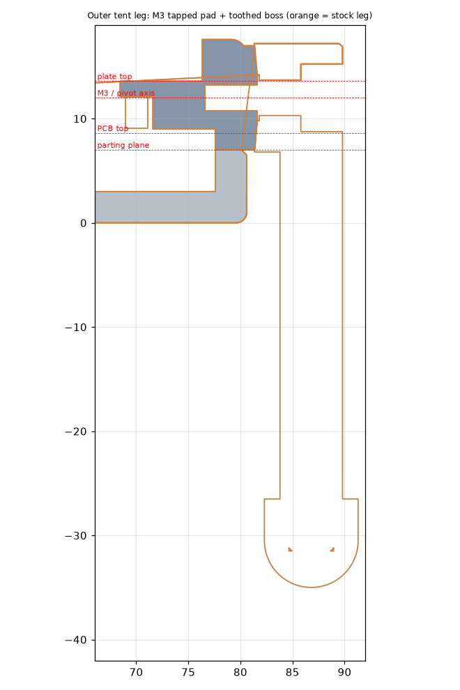 |

The custom leg and its toothed face:

| Leg | Toothed face |
|---|---|
| 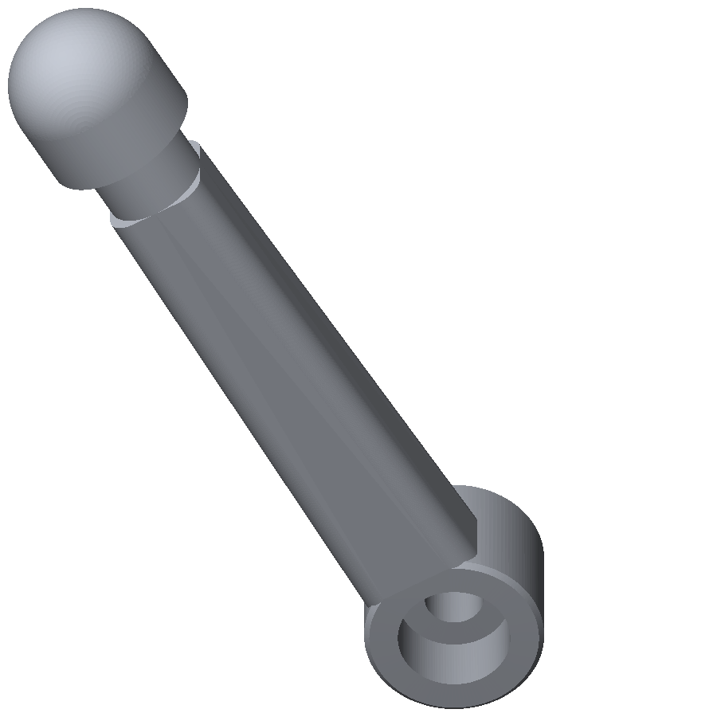 | 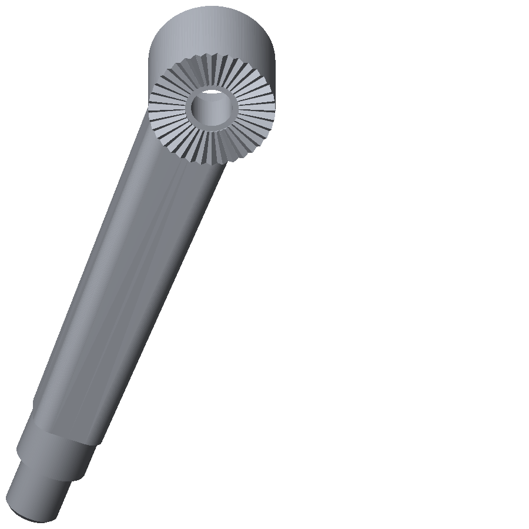 |

The cross-sections show the PCB clamped between the top bosses and the bottom posts:

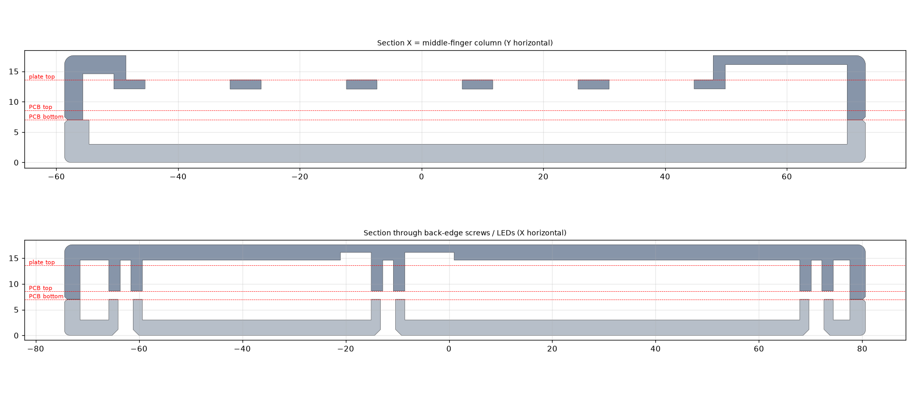

## Releasing

Push a version tag and CI builds, packages and publishes the release:

```sh
git tag -a v0.5.0 -m "v0.5.0" && git push origin v0.5.0
```

## License

[GPL-3.0-or-later](LICENSE). The switch and mounting-hole coordinates are taken from the original
ErgoDox PCB by Fredrik Atmer, which is GPLv3, so this derivative uses the same licence.
"ErgoDox EZ" is a product of ZSA Technology Labs. This project is not affiliated with or endorsed by ZSA.
